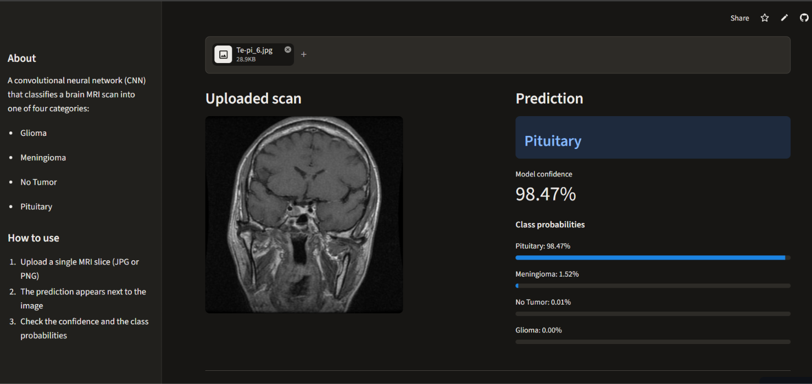
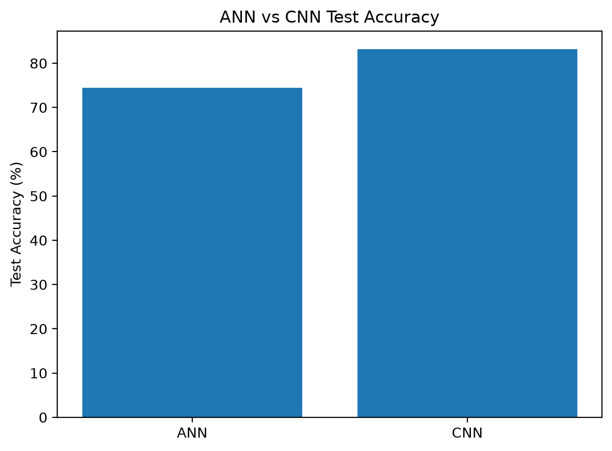
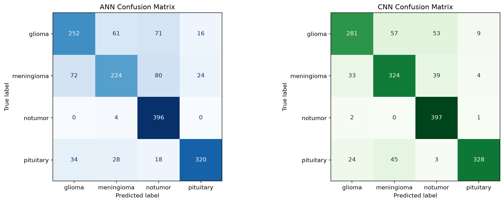
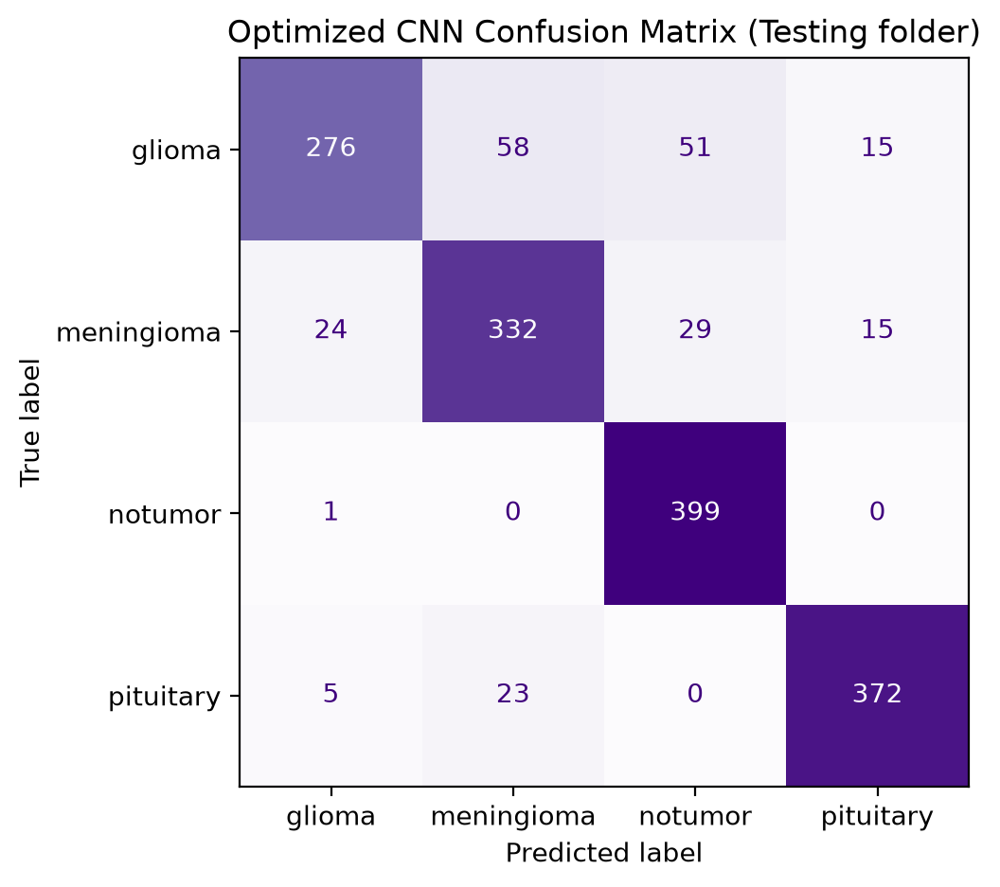
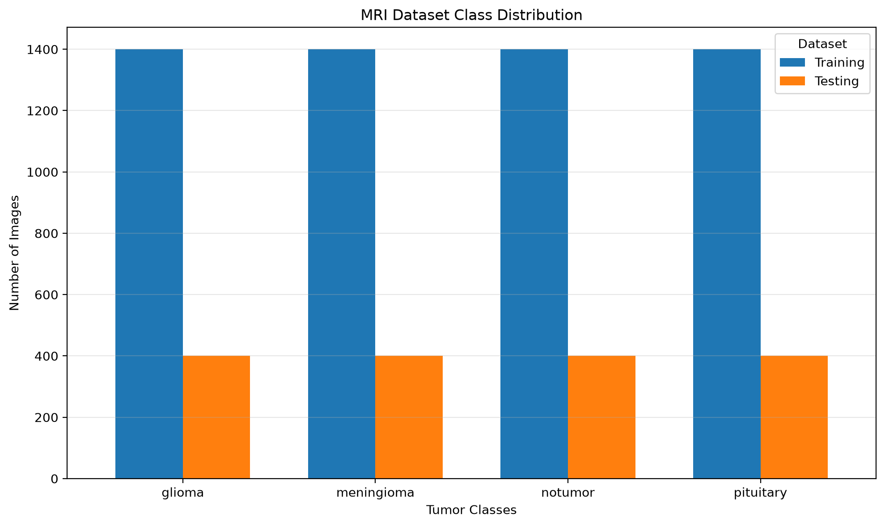
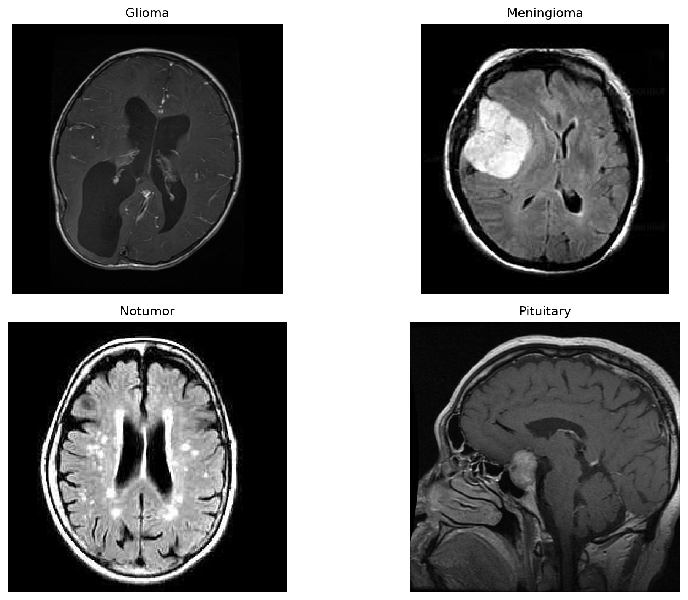

#  MRI Brain Tumor Classification

A deep-learning project that classifies a brain MRI scan into one of four classes: **glioma**, **meningioma**, **pituitary tumor**, or **no tumor**. It covers the full workflow: data exploration, preprocessing, ANN and CNN models, evaluation, tuning, and deployment as a Streamlit web app.

> **Disclaimer:** This is an educational project. It is **not a medical diagnostic tool** and must not be used for diagnosis or treatment decisions. Always consult a qualified doctor.

**Live demo:** TODO: add your Streamlit link
** Dataset:** TODO: add dataset name and source link



---

## Highlights

- Full pipeline: EDA → preprocessing → ANN → CNN → evaluation → tuning → deployment
- Compared an ANN baseline with a CNN on a held-out **Testing set of 1,600 images** the models never saw during training
- Found and handled data problems: mixed image formats, different image sizes, and duplicate images
- Reduced overfitting with dropout and a learning-rate and model-size search
- Deployed as a Streamlit app, with a Dockerfile for containerized runs

---

## Results

All numbers below are measured on the **Testing folder (1,600 images, 400 per class)**.

| Model | Test accuracy | Macro F1 |
|---|---|---|
| ANN (fully connected) | 74.5% | 0.74 |
| CNN (baseline) | 83.1% | 0.83 |
| **Optimized CNN** (dropout 0.5, lr 0.001) | **TODO: add test accuracy** | **TODO** |

The optimized CNN reached about **97% training accuracy and 93.3% validation accuracy**, with a much smaller gap between the two than the baseline CNN (about 99% and 90%).



**Baseline CNN, per class (Testing folder):**

| Class | Precision | Recall | F1 |
|---|---|---|---|
| glioma | 0.83 | 0.70 | 0.76 |
| meningioma | 0.76 | 0.81 | 0.78 |
| notumor | 0.81 | 0.99 | 0.89 |
| pituitary | 0.96 | 0.82 | 0.88 |





**What the results show**
- The CNN beats the ANN by about 9 percentage points. Flattening an image for an ANN throws away the 2D structure that a CNN keeps.
- "No tumor" is found almost perfectly (recall 0.99), but the baseline CNN labels **95 of 1,200 real tumor images as "notumor"**. In a medical setting this is the most serious kind of mistake.
- Glioma has the lowest recall (0.70), and glioma and meningioma are the classes most often confused.
- Validation accuracy was higher than test accuracy, because validation images were a random slice of the Training folder. The Testing folder is the honest number to report.

---

## Dataset

**7,200 MRI images** in four classes, already split into folders:

| Split | glioma | meningioma | notumor | pituitary | Total |
|---|---|---|---|---|---|
| Training | 1,400 | 1,400 | 1,400 | 1,400 | 5,600 |
| Testing | 400 | 400 | 400 | 400 | 1,600 |





**Data checks (notebook 01):**
- **No corrupted images** (7,196 JPEG and 4 PNG files).
- **Mixed colour modes** (RGB, grayscale, RGBA, palette): every image is loaded as 1-channel grayscale.
- **Different image sizes:** about 70% are 512 x 512, the rest vary and some are not square. Everything is resized to 224 x 224.
- **Duplicate images:** 153 groups of identical files (340 files, 7,013 unique images). **No image appears in both Training and Testing**, so the test results are not inflated by exact copies.

---

## Method

| Step | Notebook | What it does |
|---|---|---|
| 1 | `01_dataset_exploration` | Class balance, sample images, corrupted files, formats and sizes, duplicate detection |
| 2 | `02_preprocessing` | Resize to 224 x 224, grayscale, divide by 255, label encoding, duplicate removal, 80/20 train/validation split, augmentation demo |
| 3 | `03_ann_model` | ANN baseline: Dense 256 → 128 → 64 → 4 on flattened images |
| 4 | `04_cnn_model` | CNN: 2 convolution + pooling blocks, Dense 128, softmax output |
| 5 | `05_model_evaluation` | Test accuracy, confusion matrices, precision/recall/F1, error analysis |
| 6 | `06_model_optimization` | Model-size, learning-rate and dropout experiments; final optimized CNN |

**Final model:** `Conv(32) → MaxPool → Conv(64) → MaxPool → Flatten → Dense(128) → Dropout(0.5) → Dense(4, softmax)`, about 25.7 million parameters. Input: a 224 x 224 grayscale image. Training: Adam (learning rate 0.001), sparse categorical cross-entropy, batch size 16, 10 epochs.

**Tuning findings (validation set)**
- Model size: small, baseline and large CNNs reached about the same best validation accuracy (92% to 93%), so the baseline size was kept.
- Learning rate: 0.01 failed to learn (25%, which is guessing for 4 classes), 0.0001 was slower, and **0.001** was best.
- Dropout: dropout 0.5 shrank the gap between training and validation accuracy from about 7 points to about 3 points and gave the lowest validation loss.


---

## Project structure

```
MRI-Brain-Tumor-Classification/
├── app/
│   └── app.py                  # Streamlit web app (UI only)
├── src/
│   ├── __init__.py
│   ├── config.py               # model path, image size, class names
│   ├── preprocess.py           # image → model input (same steps as training)
│   └── predict.py              # loads the model once, returns the prediction
├── notebooks/                  # 01 to 06, run in order
├── models/                     # trained models (.keras)
├── images/                     # figures used in this README
├── dataset/                    # Training/ and Testing/ (not included in the repo)
├── Dockerfile
├── requirements.txt            # packages needed to run the app
├── requirements-dev.txt        # extra packages for the notebooks
└── README.md
```

---

## Run it locally

**1. Install**
```bash
python -m venv .venv
.venv\Scripts\activate          # Windows (Mac/Linux: source .venv/bin/activate)
pip install -r requirements.txt
```

**2. Start the app**
```bash
streamlit run app/app.py
```
Open http://localhost:8501 and upload an MRI image (JPG or PNG).

**3. Or run with Docker**
```bash
docker build -t mri-app .
docker run -p 8501:8501 mri-app
```

**4. Use the model from Python**
```python
from src.predict import predict_mri

result = predict_mri("path/to/mri_image.jpg")
print(result["predicted_class"], result["confidence"])
```

**Re-run the notebooks:** `pip install -r requirements-dev.txt`, place the dataset in `dataset/Training/` and `dataset/Testing/`, then run notebooks 01 to 06 in order.

---

## Tech stack

Python 3.13 · TensorFlow / Keras 2.21 · Streamlit · NumPy · Pillow · scikit-learn · pandas · Matplotlib · Docker

---

## Limitations

- **Not a clinical tool.** The model was trained on one public image set and is not validated on real patients, scanners, or hospitals.
- **Single 2D slices.** Real diagnosis uses full 3D scans, patient history, and expert review.
- **Missed tumors.** A noticeable share of tumor images is labelled "notumor" (95 of 1,200 for the baseline CNN).
- **Validation vs test gap.** Validation accuracy (about 90% to 93%) is higher than test accuracy for the baseline CNN (83.1%), so always compare models on the Testing folder.
- **Training split.** The models in notebooks 03 to 06 were trained on their own 80/20 split of the Training folder, without removing the duplicate copies that notebook 02 removes. Validation numbers can therefore be slightly optimistic. The Testing folder shares no identical file with Training.
- **Augmentation** was explored in notebook 02 but is not used in the final model. It is a possible future improvement.

## Future work

- Add data augmentation (small rotations, shifts, zoom) to the CNN
- Try transfer learning (for example ResNet or EfficientNet)
- Use class-wise recall as the main metric and reduce missed tumors
- Add Grad-CAM heatmaps to show which part of the scan drove the prediction

---

## Author

**Shreyas HS**
TODO: add your GitHub and LinkedIn links
